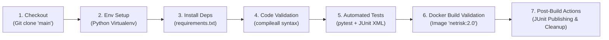

# NETRISK — Jenkins CI/CD Pipeline Guide

This document provides a comprehensive operational guide for the Jenkins Continuous Integration and Continuous Delivery (CI/CD) pipeline for **NETRISK** (Enterprise Risk-Aware SDLC Decision Platform).

---

## 1. Pipeline Architecture & Stages

The NETRISK pipeline is defined declaratively in the root [Jenkinsfile](file:///c:/PROJECTS/NetRisk/Jenkinsfile). It executes non-destructive verification of code syntax, dependency health, automated unit and integration tests, and container image buildability across cross-platform Jenkins agents (Linux and Windows).



### Stage Summary

| Stage | Goal | Tooling | Behavior & Artifacts |
| :--- | :--- | :--- | :--- |
| **1. Checkout** | Clones source code | GitSCM | Clones `https://github.com/KalpitaGharat/NetRisk.git` on branch `main`. |
| **2. Environment Setup** | Creates isolated runtime | `python3 -m venv` or `python -m venv` | Sets up clean virtual environment `.venv-ci` on agent. |
| **3. Install Dependencies**| Installs project dependencies | `pip install -r requirements.txt` | Installs FastAPI, Uvicorn, SQLAlchemy, Streamlit, Pytest, and Pydantic. |
| **4. Code Validation** | Syntax and bytecode check | `python -m compileall` | Validates syntax across `backend`, `tests`, `pages`, `services`, and `app.py`. |
| **5. Automated Tests** | Executes full test suite | `pytest --junitxml=test-results.xml` | Runs all 60 unit and integration tests; records test metrics. |
| **6. Docker Build Validation** | Verifies container build | `docker build -t netrisk:2.0 .` | Builds the single-stage React + FastAPI container without starting services. |
| **7. Post-Build Summary** | Status reporting & cleanup | Jenkins JUnit plugin & post scripts | Publishes JUnit test dashboard and cleans up ephemeral `.venv-ci`. |

---

## 2. Agent Prerequisites & Capabilities

The pipeline is designed to execute safely on standard Jenkins agents without requiring elevated privileges.

### Operating System Support
- **Linux Agents (Recommended):** Ubuntu 20.04+, Debian 11+, RHEL 8+, or Alpine Linux with glibc.
- **Windows Agents:** Windows Server 2019+ or Windows 10/11 agent with PowerShell/CMD.
- The pipeline uses declarative `isUnix()` checks to automatically execute native shell (`sh`) on POSIX agents and batch (`bat`) on Windows agents.

### Required Software on Jenkins Agent
1. **Python 3.10+ (Recommended Python 3.11):**
   - Must be installed and reachable in `PATH` as `python3` or `python`.
   - The standard library `venv` and `ensurepip` modules must be present.
2. **Git CLI:**
   - Git 2.25+ installed and available in `PATH`.
3. **Docker Engine / CLI (Optional for Build Validation):**
   - Docker CLI must be present if Docker build validation is enabled.
   - On Linux agents, the `jenkins` user must belong to the `docker` group (`sudo usermod -aG docker jenkins`).
   - If Docker is not available on the agent, the pipeline logs a notice and continues safely without failing.
4. **Node.js:**
   - **NOT required on host Jenkins agent.** The frontend compilation (React 18 + Vite) occurs inside the single-stage Docker build via in-image Node.js and npm.

---

## 3. Required Jenkins Plugins

Ensure the following standard Jenkins plugins are installed via **Manage Jenkins &rarr; Plugins**:

- **Pipeline** (`workflow-aggregator`) — Declarative pipeline execution.
- **Git plugin** (`git`) — SCM checkout and webhook triggers.
- **JUnit Plugin** (`junit`) — Parsing and publishing `test-results.xml` into interactive test result trends.
- **Pipeline: Stage View Plugin** (`pipeline-stage-view`) or **Blue Ocean** — Visual stage pipeline monitoring.
- **Credentials Plugin** (`credentials`) — Safe credential storage for optional private tokens.

---

## 4. How to Configure the Jenkins Pipeline Job

### Option A: Standard Pipeline (Pipeline script from SCM) — Recommended

1. Open Jenkins Dashboard &rarr; **New Item**.
2. Enter item name: `NETRISK-CI` &rarr; Select **Pipeline** &rarr; Click **OK**.
3. Under **General**:
   - Check **Discard old builds** (Max # of builds: `10`).
   - Check **GitHub project** &rarr; Project url: `https://github.com/KalpitaGharat/NetRisk/`
4. Under **Build Triggers**:
   - Check **GitHub hook trigger for GITScm polling** (or Poll SCM if webhooks are not configured).
5. Under **Pipeline**:
   - Definition: **Pipeline script from SCM**
   - SCM: **Git**
   - Repository URL: `https://github.com/KalpitaGharat/NetRisk.git`
   - Credentials: `- none -` (Repository is public)
   - Branch Specifier: `*/main`
   - Script Path: `Jenkinsfile`
   - Lightweight checkout: **Checked**
6. Click **Save**.

### Option B: Multibranch Pipeline

1. Open Jenkins Dashboard &rarr; **New Item**.
2. Enter name: `NETRISK-Multibranch` &rarr; Select **Multibranch Pipeline** &rarr; Click **OK**.
3. Under **Branch Sources** &rarr; Add source: **Git**.
4. Set Repository URL: `https://github.com/KalpitaGharat/NetRisk.git`.
5. Under **Build Configuration**:
   - Mode: **by Jenkinsfile**
   - Script Path: `Jenkinsfile`
6. Click **Save**. Jenkins will automatically scan all branches and pull requests and create dedicated build pipelines.

---

## 5. How to Run the First Build

1. Navigate to the `NETRISK-CI` job in Jenkins.
2. In the left navigation sidebar, click **Build Now**.
3. Once the build begins, click the build number (e.g. `#1`) to view execution status.
4. Open **Console Output** to observe live step-by-step logs.

---

## 6. How to Inspect Logs and Test Reports

### Pipeline Stage View
The Jenkins dashboard provides a stage visualization table showing each stage's duration and status (Green = Passed, Red = Failed, Amber = Unstable):
- Checkout &rarr; Environment Setup &rarr; Install Dependencies &rarr; Code Validation &rarr; Automated Tests &rarr; Docker Build Validation.

### Test Result Trend & JUnit Dashboard
After the **Automated Tests** stage completes:
1. Click **Test Result** in the build sidebar menu.
2. The interactive JUnit dashboard displays:
   - **Total Tests:** 54
   - **Passed:** 54
   - **Failed:** 0
   - **Skipped:** 0
3. Drill down by test module:
   - `backend.tests.test_api` (12 tests)
   - `backend.tests.test_integrations` (10 tests)
   - `backend.tests.test_recommendation` (4 tests)
   - `backend.tests.test_risk_engine` (6 tests)
   - `backend.tests.test_sdlc_engine` (6 tests)
   - `backend.tests.test_web_routes` (10 tests)
   - `tests.test_streamlit_services` (6 tests)

---

## 7. Troubleshooting Guide

### 1. `python3: command not found` or `python: command not found`
- **Cause:** Python is not installed on the Jenkins agent or is not in the system `PATH`.
- **Solution:** Install Python 3.11 on the agent:
  - Linux: `sudo apt-get update && sudo apt-get install -y python3 python3-venv python3-pip`
  - Windows: Install Python from [python.org](https://www.python.org/) and ensure "Add Python to PATH" is checked.
  - Restart the Jenkins agent service so environment variables are refreshed.

### 2. `docker: command not found` or `permission denied while trying to connect to the Docker daemon socket`
- **Cause:** Docker is missing or the `jenkins` user lacks permission to access `/var/run/docker.sock`.
- **Solution:**
  - Add the Jenkins user to the docker group:
    ```bash
    sudo usermod -aG docker jenkins
    sudo systemctl restart jenkins
    ```
  - Note: The pipeline gracefully detects missing Docker and skips image building without failing the build.

### 3. Dependency Installation Timeout or Network Failure
- **Cause:** Restricted egress or firewall blocking PyPI package downloads.
- **Solution:**
  - Configure pip index mirror or corporate proxy:
    ```bash
    pip config set global.index-url https://pypi.org/simple
    ```

### 4. Automated Test Failures
- **Cause:** A code change broke an API contract or risk calculation formula.
- **Local Reproduction:**
  Run the exact command locally in your terminal:
  ```bash
  python -m pytest --junitxml=test-results.xml
  ```
  Review the failed assertion in the console output or the generated `test-results.xml`.

### 5. Port Conflicts
- **Clarification:** The Jenkins pipeline executes **build-only validation** (`docker build`). It intentionally does **not** launch the container (`docker run` or `docker compose up`) during CI, preventing port binding collisions on host ports `8000` or `8001`.

---

## 8. Limitations & Security Guardrails

1. **Non-Destructive Execution:** The CI pipeline does not deploy containers to production or manipulate external cloud infrastructure (AWS/Terraform). Deployment remains separated for safety.
2. **Database Isolation:** Unit tests run with isolated in-memory or ephemeral test databases. The persistent production SQLite database (`database/netrisk.db`) is never modified during CI.
3. **External Integrations:** If Jira or Confluence credentials are not configured in the Jenkins environment, integration tests automatically execute in mocked/disconnected mode, ensuring deterministic CI runs without exposing secrets.
4. **Zero Embedded Secrets:** The `Jenkinsfile` contains no API keys, tokens, or credentials. Any future authenticated stages should pull secrets exclusively from the Jenkins Credentials Store via `withCredentials(...)`.
